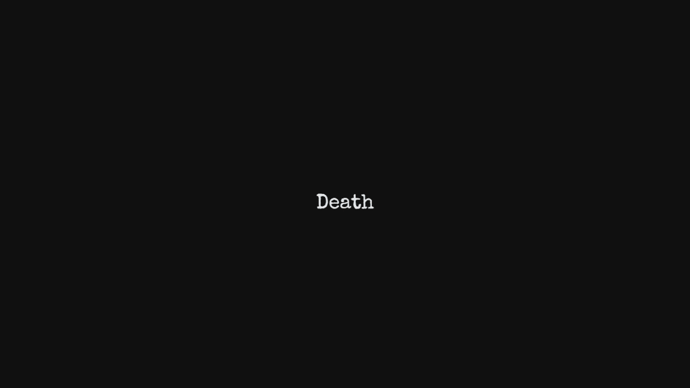

# Death

This is a small website made for Boba Bash GRN X 3AM  
It focuses on the scariest and the most chilling fact about life, Death.
 
Death is the one thing unanimous amongst all beings.
This website is a small monologue, a different world, where you dont exist, but life moves on.  

# How To Play
### Runnning Locally
1. Clone the repo 
2. Open the first Index.html file in your browser and play from that points on

### Play online
Go onto [Death](https://thedespicablejam.github.io/Death/) to play. 

# Tech Stack and Design

## Design
The site uses a dark background along with white text and fade in animations to really sell the idea of a "creepy" vibe.  
Along with that I used CSS animations for a mild glitch effect, and on the final page I have added pictures of funerals and rituals from different cultures to truly signify that Death is the only objective, ultimate truth amongst all.

## Tech Stack
This is a pretty short site with just a monologue and a few animations so I tried and keep it as simple as possible with only the vanilla web dev tech stack
<ul>
<li>HTML</li>
<li>JavaScript</li>
<li>CSS</li>
</ul>

# AI Declaration
No AI was used in the making of this project, including its code, artwork, and other assets.